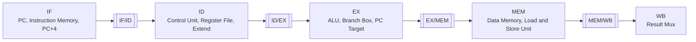

# Architecture

[Back to README](../README.md)

Colour guide: **red** = data, **blue** = control signals, **green** = hazard unit signals, **orange** = pipeline registers and clock.

## Stage Overview

## How the Pipeline Works

Think of a car factory line. While one car is being painted, the next one is being assembled.
The processor does the same: while one instruction is executing, the next one is already being decoded, and the one after that is being fetched.

| Stage | What happens | Main modules |
|---|---|---|
| **IF** (Instruction Fetch) | Read the instruction at address `PC`. Calculate `PC + 4`. Choose the next PC. | `pc`, `instruction_memory`, `pc_4adder`, `mux3` |
| **ID** (Instruction Decode) | Decode the instruction. Read two registers. Build the immediate value. | `control_unit`, `register_file`, `extend` |
| **EX** (Execute) | ALU calculation. Decide whether a branch is taken. Calculate the jump target. | `alu`, `branch_box`, `pc_target`, `mux1`, `mux4`, `mux5`, `mux6`, `PCsrc_Logic` |
| **MEM** (Memory) | Read or write data memory. | `data_memory`, `load_unit`, `store_unit` |
| **WB** (Write Back) | Choose the final result and write it into the register file. | `mux2`, `register_file` |

### Pipeline timeline (no hazards)

One new instruction starts every clock cycle.

| Cycle | 1 | 2 | 3 | 4 | 5 | 6 | 7 | 8 |
|---|---|---|---|---|---|---|---|---|
| Instruction 1 | IF | ID | EX | MEM | WB | | | |
| Instruction 2 | | IF | ID | EX | MEM | WB | | |
| Instruction 3 | | | IF | ID | EX | MEM | WB | |
| Instruction 4 | | | | IF | ID | EX | MEM | WB |

### Next-PC selection

| `PCsrc` | Next PC | When |
|---|---|---|
| 0 | `PC + 4` | normal flow |
| 1 | `jump` | branch taken, `JAL`, or `JALR` (decided in the EX stage) |

`PCsrc = Jump_E | (Branch_E & BranchTaken)`

### Result selection (WB stage)

| `ResultSrc` | Result written to register | Used by |
|---|---|---|
| `00` | `ALUresult` | R-type, I-type ALU |
| `01` | `LoadData` | loads |
| `10` | `PC + 4` | `JAL`, `JALR` (return address) |

## Module Index

| Module | Stage | What it does |
|---|---|---|
| `pc` | IF | holds the current PC, does not update when `Stall_F = 1` |
| `instruction_memory` | IF | 1024 x 32-bit ROM, loaded from `program.hex` |
| `pc_4adder` | IF | calculates `PC + 4` |
| `mux3` | IF | chooses next PC: `PC + 4` or `jump` (by `PCsrc`) |
| `IF_ID` | IF/ID | pipeline register, supports stall and flush |
| `control_unit` | ID | decodes opcode, funct3, funct7 into control signals |
| `register_file` | ID / WB | 32 x 32-bit registers, 2 read ports, 1 write port, `x0` = 0 |
| `extend` | ID | builds the immediate for I, S, B, J types |
| `ID_EX` | ID/EX | pipeline register, supports flush |
| `alu` | EX | arithmetic, logic, shift, compare |
| `branch_box` | EX | checks the branch condition (BEQ, BNE, BLT, BGE, BLTU, BGEU) |
| `pc_target` | EX | calculates `PC + immediate` |
| `PCsrc_Logic` | EX | creates `PCsrc` from `Jump_E`, `Branch_E`, `BranchTaken` |
| `mux1` | EX | ALU second input: register value or immediate |
| `mux4` | EX | jump target: `PC + imm` (JAL, branch) or `rs1 + imm` (JALR) |
| `mux5` | EX | forwarding mux for ALU input A |
| `mux6` | EX | forwarding mux for register value B (also used as store data) |
| `EX_MEM` | EX/MEM | pipeline register |
| `data_memory` | MEM | 1024 x 32-bit RAM, write on clock edge, read always |
| `store_unit` | MEM | prepares data for SB, SH, SW |
| `load_unit` | MEM | selects and extends data for LB, LH, LW, LBU, LHU |
| `MEM_WB` | MEM/WB | pipeline register |
| `mux2` | WB | chooses result: ALU, load data, or PC + 4 |
| `hazard_unit` | all | forwarding, stall, flush |
| `datapath` | top | connects everything together (inputs: `clk`, `reset`) |

## Pipeline Registers

| Register | Carries forward |
|---|---|
| **IF/ID** | `instruction`, `PC`, `PC + 4` |
| **ID/EX** | control signals (`RegWrite`, `ResultSrc`, `LoadType`, `MemWrite`, `StoreType`, `Jump`, `Branch`, `ALUcontrol`, `ALUsrc`, `JumpItr`), `RD1`, `RD2`, `immext`, `PC`, `PC + 4`, `instruction` |
| **EX/MEM** | `RegWrite`, `ResultSrc`, `LoadType`, `MemWrite`, `StoreType`, `ALUresult`, `RD2`, `PC + 4`, `instruction` |
| **MEM/WB** | `RegWrite`, `ResultSrc`, `ALUresult`, `LoadData`, `PC + 4`, `instruction` |

The full `instruction` is carried along so the hazard unit can read `rs1`, `rs2` and `rd` of the instruction in each stage.

| Register | Reset | Stall | Flush |
|---|---|---|---|
| IF/ID | yes | yes (`Stall_D`) | yes (`Flash_D`) |
| ID/EX | yes | no | yes (`Flash_E`) |
| EX/MEM | yes | no | no |
| MEM/WB | yes | no | no |
