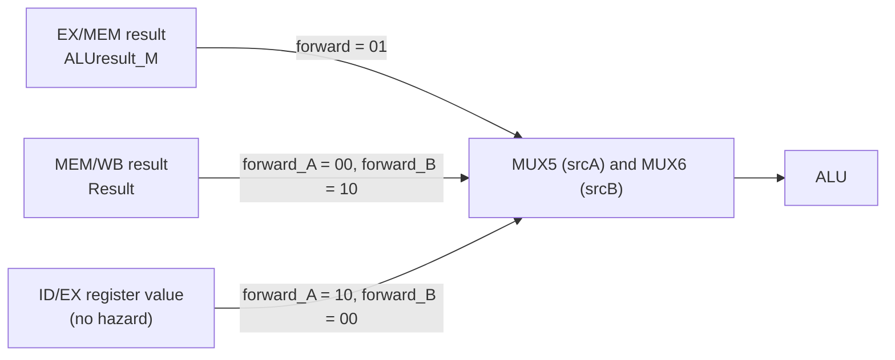

# Hazard Unit

[Back to README](../README.md)

A **hazard** is a situation where the pipeline would give a wrong answer if it just kept going.
The **Hazard Unit** watches the instructions in every stage and fixes three kinds of problems.

| Hazard | Example | Fix | Signals |
|---|---|---|---|
| Data hazard (result not written yet) | `ADD x3,...` then `SUB x4,x3,...` | **Forwarding** | `forward_A`, `forward_B` |
| Load-use hazard (data not read yet) | `LW x2,...` then `ADD x4,x2,...` | **Stall 1 cycle** | `Stall_F`, `Stall_D`, `Flash_E` |
| Control hazard (wrong instructions fetched) | taken branch, `JAL`, `JALR` | **Flush 2 instructions** | `Flash_D`, `Flash_E` |

> In the code, the flush signals are named `Flash_D` and `Flash_E`. They mean "flush".

## Forwarding

Instead of waiting for the register file, the newest value is sent straight to the ALU input.



| Condition | Meaning | `forward_A` | `forward_B` |
|---|---|---|---|
| `Rs == RdM` and `RegWrite_M` and `Rs != 0` | take it from the MEM stage (newest value, checked first) | `01` | `01` |
| `Rs == RdW` and `RegWrite_W` and `Rs != 0` | take it from the WB stage | `00` | `10` |
| none of the above | use the value read in ID | `10` | `00` |

`Rs` means `Rs1E` for `forward_A` and `Rs2E` for `forward_B`.

**Example**

```
ADD x3, x1, x2
SUB x4, x3, x5      <- needs x3 right away
```

| Cycle | 1 | 2 | 3 | 4 | 5 | 6 |
|---|---|---|---|---|---|---|
| `ADD x3,x1,x2` | IF | ID | EX | MEM | WB | |
| `SUB x4,x3,x5` | | IF | ID | **EX** | MEM | WB |

In cycle 4, `SUB` is in EX and `ADD` is in MEM. The hazard unit sends `ALUresult_M` to the ALU (`forward_A = 01`), so no waiting is needed.

## Load-use stall

A load only gets its data in the MEM stage, so forwarding alone is too late for the very next instruction. The pipeline must wait **1 cycle**.

**Condition:** the instruction in EX is a load (`ResultSrc_E = 01`) and its `rd` is the same as `Rs1D` or `Rs2D` of the instruction in ID.

| Action | Signal | Effect |
|---|---|---|
| Freeze the PC | `Stall_F = 1` | same instruction is fetched again |
| Freeze IF/ID | `Stall_D = 1` | instruction in ID stays in ID |
| Insert a bubble (NOP) in EX | `Flash_E = 1` | ID/EX register is cleared |

**Example**

```
LW  x2, 0(x1)
ADD x4, x2, x3      <- needs x2, but the load has not read memory yet
```

| Cycle | 1 | 2 | 3 | 4 | 5 | 6 | 7 |
|---|---|---|---|---|---|---|---|
| `LW x2,0(x1)` | IF | ID | EX | MEM | WB | | |
| `ADD x4,x2,x3` | | IF | ID | **ID (stall)** | EX | MEM | WB |

In cycle 5, `LW` is in WB, so `ADD` takes the loaded value by forwarding (`Result`).

## Branch and jump flush

The branch is decided in the **EX stage**. By then, two wrong instructions have already entered the pipeline, so they are cleared.

**Condition:** `PCsrc = 1` (taken branch, `JAL`, or `JALR`).

| Action | Signal | Effect |
|---|---|---|
| Clear IF/ID | `Flash_D = 1` | wrong instruction in IF is removed |
| Clear ID/EX | `Flash_E = 1` | wrong instruction in ID is removed |

Cost: **2 cycles lost** for every taken branch or jump.

| Cycle | 1 | 2 | 3 | 4 | 5 | 6 |
|---|---|---|---|---|---|---|
| `BEQ` (taken) | IF | ID | **EX** (decided) | MEM | WB | |
| wrong instruction 1 | | IF | ID | flushed | | |
| wrong instruction 2 | | | IF | flushed | | |
| branch target | | | | IF | ID | EX |

## Hazard unit ports

| Direction | Signal | Meaning |
|---|---|---|
| Input | `Rs1D`, `Rs2D` | source registers of the instruction in ID |
| Input | `Rs1E`, `Rs2E` | source registers of the instruction in EX |
| Input | `RdE`, `RdM`, `RdW` | destination register in EX, MEM, WB |
| Input | `RegWrite_M`, `RegWrite_W` | will the instruction in MEM / WB write a register? |
| Input | `ResultSrc_E` | tells whether the instruction in EX is a load |
| Input | `PCsrc` | branch or jump taken |
| Output | `forward_A`, `forward_B` | forwarding mux selects |
| Output | `Stall_F`, `Stall_D` | freeze PC and IF/ID |
| Output | `Flash_D`, `Flash_E` | clear IF/ID and ID/EX |
