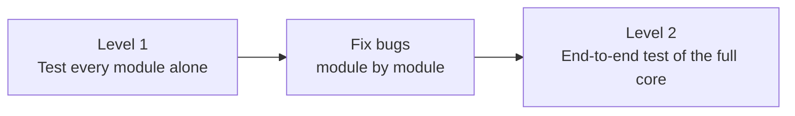

# Verification

[Back to README](../README.md)

Testbenches are **self-checking**: they print `PASS` or `FAIL` by themselves, so nobody has to read waveforms to know the result.

## Plan

Testing is done in two levels. Small blocks are proven first, so that when the full core is tested, a failure is easy to trace.



| Level | What is tested | How |
|---|---|---|
| **1. Module level** | each module alone (`pc`, `alu`, `pc_4adder`, `register_file`, `hazard_unit`, and so on) | random inputs (10,000 values) plus a few hand-written corner cases, compared with an expected value calculated inside the testbench |
| **2. End-to-end** | the full `datapath` running a real program | load `program.hex`, run the clock, then compare the final register values and data memory with the expected results |

The end-to-end program will include one case for each hazard: forwarding from MEM, forwarding from WB, load-use stall, taken branch, `JAL` and `JALR`.

## Method

**Combinational modules** (for example `alu`): drive random inputs, wait, compare.

**Clocked modules** (for example `pc`): follow the clock.

```
        negedge                posedge        +1 time unit
           |                      |                |
  TB drives random inputs   DUT captures      TB compares output
                                                with expected value
```

1. Inputs change at the **negedge**, so there is no race with the design.
2. The design captures them at the next **posedge**.
3. After `#1`, the testbench compares the output with the expected value it calculated itself.

## Status

| Module | Test | Status |
|---|---|---|
| `pc` | 10,000 random cycles, with and without stall | Verified |
| `alu` | random inputs for all 10 operations | Verified |
| `pc_4adder` | random inputs | Verified |
| `instruction_memory` | hex file load, all addresses, lower 2 address bits ignored | In progress |
| `register_file` | `x0` always 0, write only when `WE3 = 1` | In progress |
| `extend` | all immediate types | In progress |
| `control_unit` | control signals of every instruction | In progress |
| `branch_box` | all 6 branch conditions | In progress |
| `mux1` to `mux6`, `pc_target`, `PCsrc_Logic` | select inputs and outputs | In progress |
| `data_memory`, `store_unit`, `load_unit` | read, write, store and load types | In progress |
| `IF_ID`, `ID_EX`, `EX_MEM`, `MEM_WB` | reset, stall, flush, normal pass | In progress |
| `hazard_unit` | directed tests: forwarding, load-use stall, branch flush | In progress |
| Full core (`datapath`) | end-to-end program test | Planned, after the module tests |
