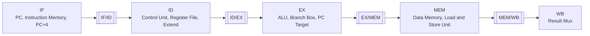
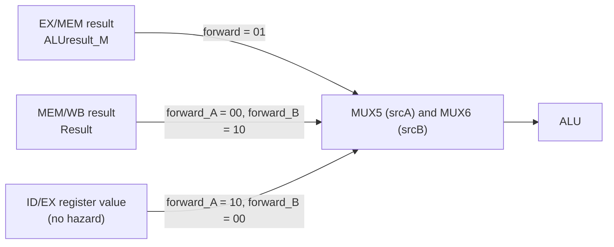
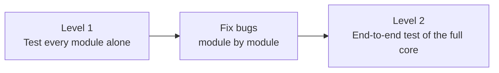

# 32-bit RISC-V 5-Stage Pipelined Processor (Verilog)

A 32-bit **RISC-V (RV32I)** processor with a **5-stage pipeline**, written in plain Verilog.
It has **data forwarding**, **load-use stalls** and **branch/jump flushing**, all handled by a separate **Hazard Unit**.

---

## At a Glance

| Item | Details |
|---|---|
| ISA | RISC-V RV32I (35 instructions, see [Instruction Set](#3-instruction-set)) |
| Pipeline | 5 stages: IF, ID, EX, MEM, WB |
| Hazard handling | Forwarding (from MEM and WB), load-use stall, branch/jump flush |
| Registers | 32 x 32-bit, `x0` is always 0 |
| Instruction memory | 1024 words (4 KB), loaded from `program.hex` |
| Data memory | 1024 words (4 KB) |
| Language | Verilog (not SystemVerilog) |
| Tools | Vivado (schematic and simulation) |

---

## Table of Contents

1. [Datapath](#1-datapath)
2. [How the Pipeline Works](#2-how-the-pipeline-works)
3. [Instruction Set](#3-instruction-set)
4. [Instruction Formats and Immediates](#4-instruction-formats-and-immediates)
5. [ALU Operations](#5-alu-operations)
6. [Hazard Handling](#6-hazard-handling)
7. [Module Index](#7-module-index)
8. [Pipeline Registers](#8-pipeline-registers)
9. [Verification](#9-verification)
10. [Repository Structure](#10-repository-structure)
11. [How to Run](#11-how-to-run)
12. [Known Limitations and Next Steps](#12-known-limitations-and-next-steps)

---

## 1. Datapath

Colour guide: **red** = data, **blue** = control signals, **green** = hazard unit signals, **orange** = pipeline registers and clock.


### Stage overview



### Vivado schematic


---

## 2. How the Pipeline Works

Think of a car factory line. While one car is being painted, the next one is being assembled.
The processor does the same: while one instruction is executing, the next one is already being decoded, and the one after that is being fetched.

| Stage | What happens | Main modules |
|---|---|---|
| **IF** (Instruction Fetch) | Read the instruction at address `PC`. Calculate `PC + 4`. Choose the next PC. | `pc`, `instruction_memory`, `pc_4adder`, `mux3` |
| **ID** (Instruction Decode) | Decode the instruction. Read two registers. Build the immediate value. | `control_unit`, `register_file`, `extend` |
| **EX** (Execute) | ALU calculation. Decide whether a branch is taken. Calculate the jump target. | `alu`, `branch_box`, `pc_target`, `mux1`, `mux4`, `mux5`, `mux6`, `PCsrc_Logic` |
| **MEM** (Memory) | Read or write data memory. | `data_memory`, `load_unit`, `store_unit` |
| **WB** (Write Back) | Choose the final result and write it into the register file. | `mux2`, `register_file` |

### Pipeline timeline (no hazards)

One new instruction starts every clock cycle.

| Cycle | 1 | 2 | 3 | 4 | 5 | 6 | 7 | 8 |
|---|---|---|---|---|---|---|---|---|
| Instruction 1 | IF | ID | EX | MEM | WB | | | |
| Instruction 2 | | IF | ID | EX | MEM | WB | | |
| Instruction 3 | | | IF | ID | EX | MEM | WB | |
| Instruction 4 | | | | IF | ID | EX | MEM | WB |

### Next-PC selection

| `PCsrc` | Next PC | When |
|---|---|---|
| 0 | `PC + 4` | normal flow |
| 1 | `jump` | branch taken, `JAL`, or `JALR` (decided in the EX stage) |

`PCsrc = Jump_E | (Branch_E & BranchTaken)`

### Result selection (WB stage)

| `ResultSrc` | Result written to register | Used by |
|---|---|---|
| `00` | `ALUresult` | R-type, I-type ALU |
| `01` | `LoadData` | loads |
| `10` | `PC + 4` | `JAL`, `JALR` (return address) |

---

## 3. Instruction Set

The core supports **35 RV32I instructions**.

| Type | Count | Instructions |
|---|---|---|
| R-type | 10 | ADD, SUB, SLL, SLT, SLTU, XOR, SRL, SRA, OR, AND |
| I-type (ALU) | 9 | ADDI, SLTI, SLTIU, XORI, ORI, ANDI, SLLI, SRLI, SRAI |
| I-type (Load) | 5 | LB, LH, LW, LBU, LHU |
| I-type (Jump) | 1 | JALR |
| S-type (Store) | 3 | SB, SH, SW |
| B-type (Branch) | 6 | BEQ, BNE, BLT, BGE, BLTU, BGEU |
| J-type (Jump) | 1 | JAL |
| **Total** | **35** | |

Not implemented yet: `LUI`, `AUIPC`, `FENCE`, `ECALL`, `EBREAK` (see [Next Steps](#12-known-limitations-and-next-steps)).

### 3.1 R-type (register and register)

Opcode `0110011`. Result = `rs1 (op) rs2`, written to `rd`.

| Instruction | What it does | funct7 | funct3 | ALUcontrol |
|---|---|---|---|---|
| `ADD` | rd = rs1 + rs2 | `0000000` | `000` | `0000` |
| `SUB` | rd = rs1 - rs2 | `0100000` | `000` | `0001` |
| `SLL` | rd = rs1 << rs2[4:0] | `0000000` | `001` | `0010` |
| `SLT` | rd = 1 if rs1 < rs2 (signed), else 0 | `0000000` | `010` | `0011` |
| `SLTU` | rd = 1 if rs1 < rs2 (unsigned), else 0 | `0000000` | `011` | `0100` |
| `XOR` | rd = rs1 ^ rs2 | `0000000` | `100` | `0101` |
| `SRL` | rd = rs1 >> rs2[4:0] (fills with 0) | `0000000` | `101` | `0110` |
| `SRA` | rd = rs1 >>> rs2[4:0] (keeps sign bit) | `0100000` | `101` | `0111` |
| `OR` | rd = rs1 \| rs2 | `0000000` | `110` | `1000` |
| `AND` | rd = rs1 & rs2 | `0000000` | `111` | `1001` |

### 3.2 I-type (ALU with immediate)

Opcode `0010011`. The second ALU input is the 12-bit immediate (sign-extended).

| Instruction | What it does | funct7 | funct3 | ALUcontrol |
|---|---|---|---|---|
| `ADDI` | rd = rs1 + imm | n/a | `000` | `0000` |
| `SLTI` | rd = 1 if rs1 < imm (signed), else 0 | n/a | `010` | `0011` |
| `SLTIU` | rd = 1 if rs1 < imm (unsigned), else 0 | n/a | `011` | `0100` |
| `XORI` | rd = rs1 ^ imm | n/a | `100` | `0101` |
| `ORI` | rd = rs1 \| imm | n/a | `110` | `1000` |
| `ANDI` | rd = rs1 & imm | n/a | `111` | `1001` |
| `SLLI` | rd = rs1 << shamt | `0000000` | `001` | `0010` |
| `SRLI` | rd = rs1 >> shamt (fills with 0) | `0000000` | `101` | `0110` |
| `SRAI` | rd = rs1 >>> shamt (keeps sign bit) | `0100000` | `101` | `0111` |

### 3.3 I-type (loads)

Opcode `0000011`. Address = `rs1 + imm`. The data read from memory goes to `rd`.

| Instruction | What it does | funct3 | LoadType |
|---|---|---|---|
| `LB` | load 1 byte, sign-extend | `000` | `000` |
| `LH` | load 2 bytes (halfword), sign-extend | `001` | `001` |
| `LW` | load 4 bytes (word) | `010` | `010` |
| `LBU` | load 1 byte, zero-extend | `100` | `100` |
| `LHU` | load 2 bytes, zero-extend | `101` | `101` |

### 3.4 S-type (stores)

Opcode `0100011`. Address = `rs1 + imm`. The value of `rs2` is written to memory.

| Instruction | What it does | funct3 | StoreType |
|---|---|---|---|
| `SB` | store lowest byte of rs2 | `000` | `00` |
| `SH` | store lowest halfword of rs2 | `001` | `01` |
| `SW` | store full word of rs2 | `010` | `10` |

### 3.5 B-type (branches)

Opcode `1100011`. If the condition is true, PC = `PC + imm`. The **Branch Box** in the EX stage checks the condition using `funct3`.

| Instruction | Branch if | funct3 | Comparison |
|---|---|---|---|
| `BEQ` | rs1 == rs2 | `000` | equal |
| `BNE` | rs1 != rs2 | `001` | not equal |
| `BLT` | rs1 < rs2 | `100` | signed |
| `BGE` | rs1 >= rs2 | `101` | signed |
| `BLTU` | rs1 < rs2 | `110` | unsigned |
| `BGEU` | rs1 >= rs2 | `111` | unsigned |

### 3.6 Jumps

| Instruction | Opcode | What it does |
|---|---|---|
| `JAL` | `1101111` | rd = PC + 4, then PC = PC + imm (J-type immediate) |
| `JALR` | `1100111` (funct3 `000`) | rd = PC + 4, then PC = (rs1 + imm) with the lowest bit cleared |

### 3.7 Control signals for every instruction

These are the signals the **Control Unit** produces in the ID stage. `-` means "not used / 0".

| Instruction group | RegWrite | ALUsrc | MemWrite | ResultSrc | ImmSrc | ALUcontrol | LoadType | StoreType | Branch | Jump | JumpItr |
|---|---|---|---|---|---|---|---|---|---|---|---|
| R-type | 1 | 0 (rs2) | 0 | `00` | `000` | by funct3/funct7 | - | - | 0 | 0 | 0 |
| I-type ALU | 1 | 1 (imm) | 0 | `00` | `001` | by funct3/funct7 | - | - | 0 | 0 | 0 |
| Loads | 1 | 1 (imm) | 0 | `01` | `001` | `0000` (ADD) | by funct3 | - | 0 | 0 | 0 |
| `JALR` | 1 | 1 (imm) | 0 | `10` | `001` | `0000` (ADD) | - | - | 0 | 1 | 1 |
| Stores | 0 | 1 (imm) | 1 | `00` | `010` | `0000` (ADD) | - | by funct3 | 0 | 0 | 0 |
| Branches | 0 | 0 | 0 | `00` | `011` | not used | - | - | 1 | 0 | 0 |
| `JAL` | 1 | 0 | 0 | `10` | `100` | not used | - | - | 0 | 1 | 0 |

---

## 4. Instruction Formats and Immediates

### 4.1 Bit layout of each format

| Type | 31:25 | 24:20 | 19:15 | 14:12 | 11:7 | 6:0 |
|---|---|---|---|---|---|---|
| **R** | funct7 | rs2 | rs1 | funct3 | rd | opcode |
| **I** | imm[11:0] (31:20) | | rs1 | funct3 | rd | opcode |
| **S** | imm[11:5] | rs2 | rs1 | funct3 | imm[4:0] | opcode |
| **B** | imm[12], imm[10:5] | rs2 | rs1 | funct3 | imm[4:1], imm[11] | opcode |
| **J** | imm[20], imm[10:1], imm[11], imm[19:12] (31:12) | | | | rd | opcode |

### 4.2 Immediate generator (`extend` module)

| `ImmSrc` | Type | Immediate built from the instruction |
|---|---|---|
| `000` | R | `0` (no immediate) |
| `001` | I | sign-extend `instr[31:20]` |
| `010` | S | sign-extend `{instr[31:25], instr[11:7]}` |
| `011` | B | sign-extend `{instr[31], instr[7], instr[30:25], instr[11:8], 0}` |
| `100` | J | sign-extend `{instr[31], instr[19:12], instr[20], instr[30:21], 0}` |

---

## 5. ALU Operations

| `ALUcontrol` | Operation | Result |
|---|---|---|
| `0000` | ADD | `srcA + srcB` |
| `0001` | SUB | `srcA - srcB` |
| `0010` | SLL | `srcA << srcB[4:0]` |
| `0011` | SLT | 1 if `srcA < srcB` (signed) |
| `0100` | SLTU | 1 if `srcA < srcB` (unsigned) |
| `0101` | XOR | `srcA ^ srcB` |
| `0110` | SRL | `srcA >> srcB[4:0]` |
| `0111` | SRA | `srcA >>> srcB[4:0]` |
| `1000` | OR | `srcA \| srcB` |
| `1001` | AND | `srcA & srcB` |

---

## 6. Hazard Handling

A **hazard** is a situation where the pipeline would give a wrong answer if it just kept going.
The **Hazard Unit** watches the instructions in every stage and fixes three kinds of problems.

| Hazard | Example | Fix | Signals |
|---|---|---|---|
| Data hazard (result not written yet) | `ADD x3,...` then `SUB x4,x3,...` | **Forwarding** | `forward_A`, `forward_B` |
| Load-use hazard (data not read yet) | `LW x2,...` then `ADD x4,x2,...` | **Stall 1 cycle** | `Stall_F`, `Stall_D`, `Flash_E` |
| Control hazard (wrong instructions fetched) | taken branch, `JAL`, `JALR` | **Flush 2 instructions** | `Flash_D`, `Flash_E` |

> In the code, the flush signals are named `Flash_D` and `Flash_E`. They mean "flush".

### 6.1 Forwarding

Instead of waiting for the register file, the newest value is sent straight to the ALU input.



| Condition | Meaning | `forward_A` | `forward_B` |
|---|---|---|---|
| `Rs == RdM` and `RegWrite_M` and `Rs != 0` | take it from the MEM stage (newest value, checked first) | `01` | `01` |
| `Rs == RdW` and `RegWrite_W` and `Rs != 0` | take it from the WB stage | `00` | `10` |
| none of the above | use the value read in ID | `10` | `00` |

`Rs` means `Rs1E` for `forward_A` and `Rs2E` for `forward_B`.

**Example**

```
ADD x3, x1, x2
SUB x4, x3, x5      <- needs x3 right away
```

| Cycle | 1 | 2 | 3 | 4 | 5 | 6 |
|---|---|---|---|---|---|---|
| `ADD x3,x1,x2` | IF | ID | EX | MEM | WB | |
| `SUB x4,x3,x5` | | IF | ID | **EX** | MEM | WB |

In cycle 4, `SUB` is in EX and `ADD` is in MEM. The hazard unit sends `ALUresult_M` to the ALU (`forward_A = 01`), so no waiting is needed.

### 6.2 Load-use stall

A load only gets its data in the MEM stage, so forwarding alone is too late for the very next instruction. The pipeline must wait **1 cycle**.

**Condition:** the instruction in EX is a load (`ResultSrc_E = 01`) and its `rd` is the same as `Rs1D` or `Rs2D` of the instruction in ID.

| Action | Signal | Effect |
|---|---|---|
| Freeze the PC | `Stall_F = 1` | same instruction is fetched again |
| Freeze IF/ID | `Stall_D = 1` | instruction in ID stays in ID |
| Insert a bubble (NOP) in EX | `Flash_E = 1` | ID/EX register is cleared |

**Example**

```
LW  x2, 0(x1)
ADD x4, x2, x3      <- needs x2, but the load has not read memory yet
```

| Cycle | 1 | 2 | 3 | 4 | 5 | 6 | 7 |
|---|---|---|---|---|---|---|---|
| `LW x2,0(x1)` | IF | ID | EX | MEM | WB | | |
| `ADD x4,x2,x3` | | IF | ID | **ID (stall)** | EX | MEM | WB |

In cycle 5, `LW` is in WB, so `ADD` takes the loaded value by forwarding (`Result`).

### 6.3 Branch and jump flush

The branch is decided in the **EX stage**. By then, two wrong instructions have already entered the pipeline, so they are cleared.

**Condition:** `PCsrc = 1` (taken branch, `JAL`, or `JALR`).

| Action | Signal | Effect |
|---|---|---|
| Clear IF/ID | `Flash_D = 1` | wrong instruction in IF is removed |
| Clear ID/EX | `Flash_E = 1` | wrong instruction in ID is removed |

Cost: **2 cycles lost** for every taken branch or jump.

| Cycle | 1 | 2 | 3 | 4 | 5 | 6 |
|---|---|---|---|---|---|---|
| `BEQ` (taken) | IF | ID | **EX** (decided) | MEM | WB | |
| wrong instruction 1 | | IF | ID | flushed | | |
| wrong instruction 2 | | | IF | flushed | | |
| branch target | | | | IF | ID | EX |

### 6.4 Hazard unit ports

| Direction | Signal | Meaning |
|---|---|---|
| Input | `Rs1D`, `Rs2D` | source registers of the instruction in ID |
| Input | `Rs1E`, `Rs2E` | source registers of the instruction in EX |
| Input | `RdE`, `RdM`, `RdW` | destination register in EX, MEM, WB |
| Input | `RegWrite_M`, `RegWrite_W` | will the instruction in MEM / WB write a register? |
| Input | `ResultSrc_E` | tells whether the instruction in EX is a load |
| Input | `PCsrc` | branch or jump taken |
| Output | `forward_A`, `forward_B` | forwarding mux selects |
| Output | `Stall_F`, `Stall_D` | freeze PC and IF/ID |
| Output | `Flash_D`, `Flash_E` | clear IF/ID and ID/EX |

---

## 7. Module Index

| Module | Stage | What it does |
|---|---|---|
| `pc` | IF | holds the current PC, does not update when `Stall_F = 1` |
| `instruction_memory` | IF | 1024 x 32-bit ROM, loaded from `program.hex` |
| `pc_4adder` | IF | calculates `PC + 4` |
| `mux3` | IF | chooses next PC: `PC + 4` or `jump` (by `PCsrc`) |
| `IF_ID` | IF/ID | pipeline register, supports stall and flush |
| `control_unit` | ID | decodes opcode, funct3, funct7 into control signals |
| `register_file` | ID / WB | 32 x 32-bit registers, 2 read ports, 1 write port, `x0` = 0 |
| `extend` | ID | builds the immediate for I, S, B, J types |
| `ID_EX` | ID/EX | pipeline register, supports flush |
| `alu` | EX | arithmetic, logic, shift, compare |
| `branch_box` | EX | checks the branch condition (BEQ, BNE, BLT, BGE, BLTU, BGEU) |
| `pc_target` | EX | calculates `PC + immediate` |
| `PCsrc_Logic` | EX | creates `PCsrc` from `Jump_E`, `Branch_E`, `BranchTaken` |
| `mux1` | EX | ALU second input: register value or immediate |
| `mux4` | EX | jump target: `PC + imm` (JAL, branch) or `rs1 + imm` (JALR) |
| `mux5` | EX | forwarding mux for ALU input A |
| `mux6` | EX | forwarding mux for register value B (also used as store data) |
| `EX_MEM` | EX/MEM | pipeline register |
| `data_memory` | MEM | 1024 x 32-bit RAM, write on clock edge, read always |
| `store_unit` | MEM | prepares data for SB, SH, SW |
| `load_unit` | MEM | selects and extends data for LB, LH, LW, LBU, LHU |
| `MEM_WB` | MEM/WB | pipeline register |
| `mux2` | WB | chooses result: ALU, load data, or PC + 4 |
| `hazard_unit` | all | forwarding, stall, flush |
| `datapath` | top | connects everything together (inputs: `clk`, `reset`) |

---

## 8. Pipeline Registers

| Register | Carries forward |
|---|---|
| **IF/ID** | `instruction`, `PC`, `PC + 4` |
| **ID/EX** | control signals (`RegWrite`, `ResultSrc`, `LoadType`, `MemWrite`, `StoreType`, `Jump`, `Branch`, `ALUcontrol`, `ALUsrc`, `JumpItr`), `RD1`, `RD2`, `immext`, `PC`, `PC + 4`, `instruction` |
| **EX/MEM** | `RegWrite`, `ResultSrc`, `LoadType`, `MemWrite`, `StoreType`, `ALUresult`, `RD2`, `PC + 4`, `instruction` |
| **MEM/WB** | `RegWrite`, `ResultSrc`, `ALUresult`, `LoadData`, `PC + 4`, `instruction` |

The full `instruction` is carried along so the hazard unit can read `rs1`, `rs2` and `rd` of the instruction in each stage.

| Register | Reset | Stall | Flush |
|---|---|---|---|
| IF/ID | yes | yes (`Stall_D`) | yes (`Flash_D`) |
| ID/EX | yes | no | yes (`Flash_E`) |
| EX/MEM | yes | no | no |
| MEM/WB | yes | no | no |

---

## 9. Verification

Testbenches are **self-checking**: they print `PASS` or `FAIL` by themselves, so nobody has to read waveforms to know the result.

### Plan

Testing is done in two levels. Small blocks are proven first, so that when the full core is tested, a failure is easy to trace.



| Level | What is tested | How |
|---|---|---|
| **1. Module level** | each module alone (`pc`, `alu`, `pc_4adder`, `register_file`, `hazard_unit`, and so on) | random inputs (10,000 values) plus a few hand-written corner cases, compared with an expected value calculated inside the testbench |
| **2. End-to-end** | the full `datapath` running a real program | load `program.hex`, run the clock, then compare the final register values and data memory with the expected results |

The end-to-end program will include one case for each hazard: forwarding from MEM, forwarding from WB, load-use stall, taken branch, `JAL` and `JALR`.

### Method

**Combinational modules** (for example `alu`): drive random inputs, wait, compare.

**Clocked modules** (for example `pc`): follow the clock.

```
        negedge                posedge        +1 time unit
           |                      |                |
  TB drives random inputs   DUT captures      TB compares output
                                                with expected value
```

1. Inputs change at the **negedge**, so there is no race with the design.
2. The design captures them at the next **posedge**.
3. After `#1`, the testbench compares the output with the expected value it calculated itself.

### Status

| Module | Test | Status |
|---|---|---|
| `pc` | 10,000 random cycles, with and without stall | Verified |
| `alu` | random inputs for all 10 operations | Verified |
| `pc_4adder` | random inputs | Verified |
| `instruction_memory` | hex file load, all addresses, lower 2 address bits ignored | In progress |
| `register_file` | `x0` always 0, write only when `WE3 = 1` | In progress |
| `extend` | all immediate types | In progress |
| `control_unit` | control signals of every instruction | In progress |
| `branch_box` | all 6 branch conditions | In progress |
| `mux1` to `mux6`, `pc_target`, `PCsrc_Logic` | select inputs and outputs | In progress |
| `data_memory`, `store_unit`, `load_unit` | read, write, store and load types | In progress |
| `IF_ID`, `ID_EX`, `EX_MEM`, `MEM_WB` | reset, stall, flush, normal pass | In progress |
| `hazard_unit` | directed tests: forwarding, load-use stall, branch flush | In progress |
| Full core (`datapath`) | end-to-end program test | Planned, after the module tests |

---

## 10. Repository Structure

```
riscv-32bit-pipelined-core/
├── README.md
├── rtl/
│   └── RTL.v              <- all modules of the design
├── tb/                    <- testbenches
├── docs/
│   ├── datapath.png       <- hand-drawn datapath
│   └── vivado_schematic.png
└── (more folders will be added, see Next Steps)
```

---

## 11. How to Run

**Vivado**

1. Create a project and add `rtl/RTL.v` as a design source.
2. Add a testbench from `tb/` as a simulation source.
3. Put `program.hex` in the simulation working folder (for example `<project>.sim/sim_1/behav/xsim`), because `instruction_memory` loads it with `$readmemh("program.hex", ...)`.
4. Run Behavioral Simulation. A self-checking testbench prints `PASS` or `FAIL` in the Tcl console.

**Icarus Verilog (optional)**

```bash
iverilog -o sim rtl/RTL.v tb/tb_pc.v
vvp sim
```

---

## 12. Known Limitations and Next Steps

| Item | Note |
|---|---|
| `LUI`, `AUIPC` | not implemented yet (needs a U-type immediate) |
| `FENCE`, `ECALL`, `EBREAK`, CSRs | not implemented |

**Next steps**

- [ ] Finish module testbenches, then the end-to-end testbench of the full core
- [ ] Add older versions in a `milestones/` folder (R, I, S types, then branches, then full single-cycle, then pipeline)
- [ ] Add `LUI` and `AUIPC`
- [ ] Waveform screenshots showing forwarding, stall and flush
- [ ] Later: branch prediction, cache, superscalar

---

## Author

**Abhinav Kushwaha**, IIIT Kottayam
Interested in RTL design and verification.
